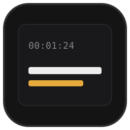

#  RosettaSubs — Stremio Multimodal Subtitles Add-on

[](https://render.com/deploy?repo=https://github.com/mwatney-mars/rosettasubs)

> Subtitles in 30+ languages from OpenSubtitles, SubDL, and Wyzie — with dual-language immersion tracks and instant AI translation when subtitles are missing in your language.

A TypeScript + Express Stremio Subtitles Add-on combining **multi-provider aggregation** (**Wyzie Subs**, **OpenSubtitles REST API v1**, **SubDL**), **Dual-Language Immersion Subtitles**, and **Multimodal AI fallback translation & audio/video transcription** (**Google Gemini** & **OpenAI-compatible** APIs).

## Features

- **Multi-Provider Parallel Aggregation**: Queries Wyzie Subs (no key required), OpenSubtitles v1 (with exact `moviehash` matching and lazy download resolution), and SubDL in parallel.
- **Dual-Language / Immersion Subtitles (`/dual/:token.srt`)**:
  - Timestamp-aligns target-language and native-reference-language tracks by maximum temporal overlap and merges overlapping cues into stacked two-line `.srt` cues (`<b>Target Line</b>` + `<font color="#999999">Native Reference Line</font>`).
  - Automatically falls back to AI translation when either the target or native track is missing.
  - Optional **Inline B2/C1 Idiom & Slang Annotations** (`[idiom: meaning]`) powered by Gemini/OpenAI for language learners.
- **Multimodal AI Fallback & Translation**:
  - Automatically generates on-the-fly AI translation tracks when a configured language is missing from upstream providers (or always, if configured).
  - Preserves exact `.srt` cue timestamps while translating dialogue in concurrent batches.
  - Exposes `POST /api/multimodal/transcribe` for direct audio/video-to-SRT transcription and translation via Gemini.
- **Subtitle Proxy & Encoding/Format Normalization**:
  - Automatically detects and converts `UTF-16LE/BE`, `Windows-1252` / `Latin1`, and `UTF-8 BOM` to clean `UTF-8`.
  - Converts `.vtt` (WebVTT), `.ass`/`.ssa` (SubStation Alpha), `.sub` (MicroDVD), and `.zip` archives into standard `.srt` on the fly.
- **In-Memory LRU + TTL Caching**: Caches provider search results, normalized `.srt` files, dual-language merges, and AI translations.
- **User Configuration UI (`/configure`)**: Interactive configuration page that encodes preferences into a stateless URL token (`/:config/manifest.json`).

## Quick Start

```bash
npm install
npm run dev
```

- **Configure UI**: `http://localhost:7000/configure`
- **Default Manifest**: `http://localhost:7000/manifest.json`
- **Health & Cache Stats**: `http://localhost:7000/health`

## Home Server + Cloudflare Tunnel Deployment (Recommended)

Run RosettaSubs on your home server behind a Cloudflare Tunnel (`cloudflared`) with zero port-forwarding:

1. In [Cloudflare Zero Trust](https://one.dash.cloudflare.com/) → **Networks → Tunnels**, create a tunnel and point your public hostname (e.g., `subs.yourdomain.com`) to `http://rosettasubs:7000`.
2. (Recommended) Add a **Cloudflare Cache Rule** for your hostname:
   - Match: `URI Path` ends with `.json` or `.srt`
   - Cache eligibility: **Eligible for cache** (Use origin `Cache-Control` headers)
3. Copy `.env.example` to `.env`, set `BASE_URL=https://subs.yourdomain.com` and `CLOUDFLARE_TUNNEL_TOKEN=<your_token>`, and start:

```bash
cp .env.example .env
docker compose up --build -d
```
